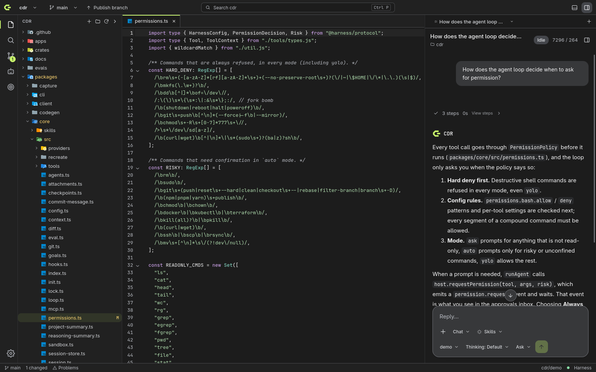
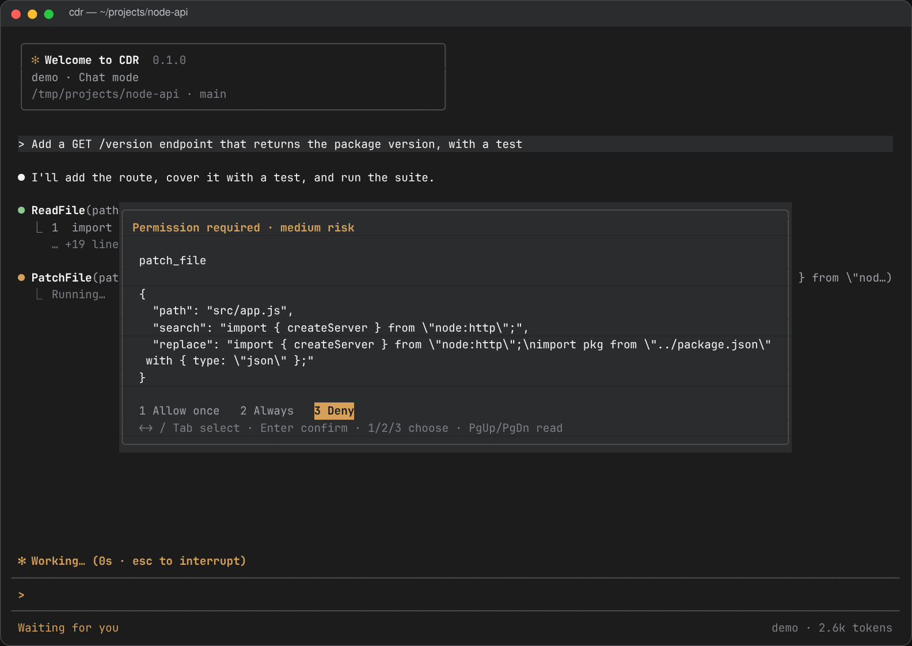

<h1 align="center">
   CDR
</h1>

<p align="center">
  <a href="https://github.com/birkmann/cdr/actions/workflows/ci.yml"></a>
  <a href="LICENSE"></a>
  
  
</p>

<p align="center">
  <strong>Code. Build. Ship.</strong><br />
  An AI coding agent you run yourself, with the models you choose.<br />
  One agent behind a terminal, a web app, and a native desktop app.
</p>

<h3 align="center"><a href="https://github.com/birkmann/cdr/releases"><ins>Download CDR</ins></a></h3>

<p align="center">
  
</p>

## Features

<table>
<tr>
<td width="50%" valign="middle">

### Terminal

Run `cdr` in any project. Responses stream in, edits show as diffs, and your test command runs before the agent reports back. `cdr run` does the same in scripts and CI, with JSONL events.

[Docs →](docs/cli.md)

</td>
<td width="50%">
  <a href="docs/cli.md"></a>
</td>
</tr>
<tr>
<td width="50%" valign="middle">

### Web workspace

`cdr serve` opens a chat with a live preview next to it. Start in a fresh sandbox or point it at a project, attach files and images, and watch the page update as the agent builds.

[Docs →](docs/web.md)

</td>
<td width="50%">
  <a href="docs/web.md"></a>
</td>
</tr>
<tr>
<td width="50%" valign="middle">

### You approve what runs

In Ask mode every edit and command waits for you. Auto mode asks only for risky commands. File tools stay inside the project, a deny list blocks destructive commands in every mode, and shell commands can run in a bubblewrap sandbox.

[Docs →](docs/configuration.md)

</td>
<td width="50%">
  <a href="docs/configuration.md"></a>
</td>
</tr>
<tr>
<td width="50%" valign="middle">

### Review and commit

CDR Studio shows the agent's changes as a diff you can stage file by file. Ask the agent to review them, generate the commit message, and commit without leaving the app.

[Docs →](docs/desktop.md#using-the-app)

</td>
<td width="50%">
  <a href="docs/desktop.md#using-the-app"></a>
</td>
</tr>
<tr>
<td width="50%" valign="middle">

### A full Git client

Browse history across branches, open any commit to see its files and diff, and manage branches, stashes, and pull requests next to the editor and terminals.

[Docs →](docs/desktop.md)

</td>
<td width="50%">
  <a href="docs/desktop.md"></a>
</td>
</tr>
</table>

Also included:

- **[Workflows](docs/workflows.md):** plan, approve, execute, verify, and review, with a separate model for each role. Write your own in the config.
- **[Skills](docs/skills.md):** instructions in the Agent Skills format that the agent loads when a task matches, or that you attach to a message with `/`. A built-in set ships with CDR.
- **[Subagents and goals](docs/workflows.md#autonomous-workflow-and-goals):** parallel helpers in their own Git worktrees, and unattended runs with acceptance criteria and a budget.
- **[Checkpoints](docs/configuration.md#checkpoints):** files are snapshotted before every turn. `/rewind` or **Restore files to here** takes the project back, and the restore can be undone.
- **[Context compaction](docs/configuration.md#context-size-and-compaction):** long jobs stay inside a fixed token budget, and compacted history stays searchable.
- **[Memory and MCP tools](docs/configuration.md):** the agent can save facts for later sessions and use tools from MCP servers.
- **[Model picker](docs/web.md):** shows what each model supports (vision, tools, thinking, context size) and sets the thinking effort.
- **[Attachment viewer](docs/web.md):** PDFs and zoomable images open next to the chat.
- **[Terminal designs](docs/cli.md):** `/terminal-design` switches between the default look and Classic.
- **[Chat output folder](docs/configuration.md):** files a chat creates go to `~/Documents/CDR`, not into your repository.
- **[Recreate a page 1:1](docs/recreate.md):** rebuild a live web page as code you own, measured against the original at every width. Opt-in, and it asks for consent on every run.
- **[Evals](evals/README.md):** `cdr eval` runs task suites against any model and compares runs.
- **[Protocol and SDK](docs/protocol.md):** every agent step is a typed event over HTTP and SSE, with JSON schemas, a [TypeScript client, and React hooks](docs/sdk.md).
- Everything else is in the [changelog](CHANGELOG.md).

## Providers

DeepSeek, Anthropic, OpenRouter, Ollama, and any OpenAI-compatible API. Local Ollama models need no API key. Set a different model for planning, executing, and reviewing in [`cdr.config.json`](docs/configuration.md).

## Install

### Desktop

Download an installer from [Releases](https://github.com/birkmann/cdr/releases):

- **Linux:** `.AppImage`, `.deb`, or `.rpm`
- **macOS:** universal `.dmg`
- **Windows:** installer or `.msi`

The macOS and Windows builds are not code-signed yet. The app needs Node.js 22 or newer and Git.

### Terminal and web app

Download `cdr-<version>.tar.gz` or `.zip` from [Releases](https://github.com/birkmann/cdr/releases). It needs Node.js 22 or newer.

```bash
tar -xzf cdr-<version>.tar.gz
cdr-<version>/bin/cdr          # terminal, in the current folder
cdr-<version>/bin/cdr serve    # web app; open the printed link
```

### From source

Install Node.js 22+, pnpm 11, and Git. The desktop app also needs Rust and the [Tauri prerequisites](docs/desktop.md#run-it).

```bash
git clone https://github.com/birkmann/cdr.git
cd cdr
pnpm install
pnpm build
cp .env.example .env  # set credentials for your provider

pnpm cdr             # terminal
pnpm cdr serve       # web app; open the printed link
pnpm desktop:dev     # desktop app
```

`pnpm desktop:build` writes installers to `target/release/bundle/`. For a global `cdr` command, run `pnpm --filter @harness/cli link --global`.

## Quick start

```bash
cdr                           # open the current project
cdr run "Fix failing tests"   # run a workflow; add --json for JSONL events
cdr serve                     # web app
cdr init                      # create cdr.config.json and AGENTS.md
```

Put provider keys in `.env` in the project, in `~/.harness/.env`, or in the desktop app's settings, which stores them in the system keychain. Providers, model roles, permissions, and verification commands are set in `cdr.config.json`; see [Configuration](docs/configuration.md).

## Development

```bash
pnpm build
pnpm test       # mock providers; no network
pnpm lint
cargo test --workspace
cargo clippy --workspace --all-targets -- -D warnings
```

Core packages live in `packages/`, interfaces in `apps/`, and the desktop backend in `crates/studio-*`. See [Contributing](CONTRIBUTING.md) for end-to-end tests, screenshots, and releases.

## Documentation

- [Terminal](docs/cli.md) · [Web](docs/web.md) · [Desktop](docs/desktop.md)
- [Configuration](docs/configuration.md) · [Workflows](docs/workflows.md) · [Skills](docs/skills.md) · [Recreate a page 1:1](docs/recreate.md)
- [Architecture](docs/architecture.md) · [Protocol](docs/protocol.md) · [SDK](docs/sdk.md) · [Brand](docs/brand.md)

## Security

CDR runs agents that can change files and run commands on your machine. Report vulnerabilities privately; see [SECURITY.md](SECURITY.md).

## License

[MIT](LICENSE). Third-party code and assets are listed in [THIRD_PARTY_NOTICES.md](THIRD_PARTY_NOTICES.md).
