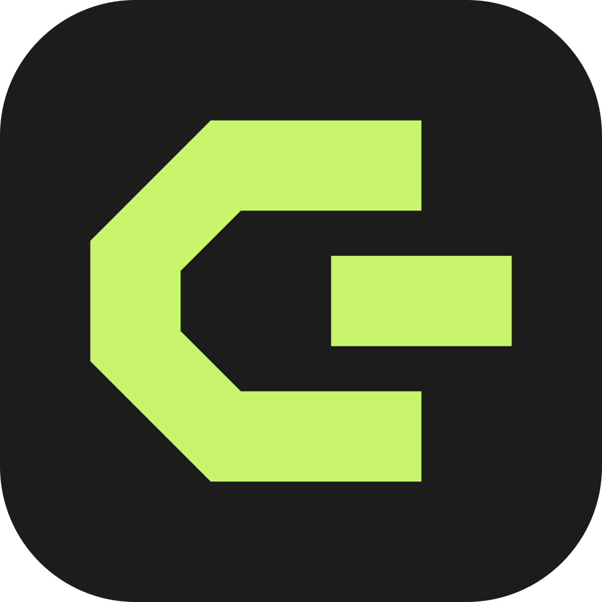
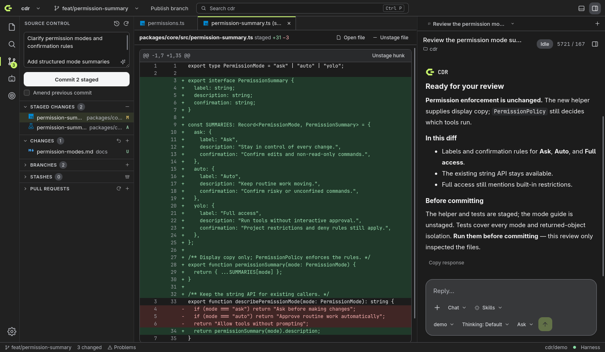
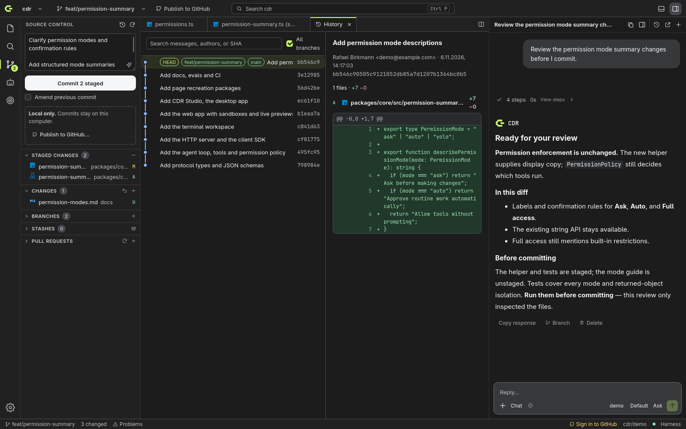
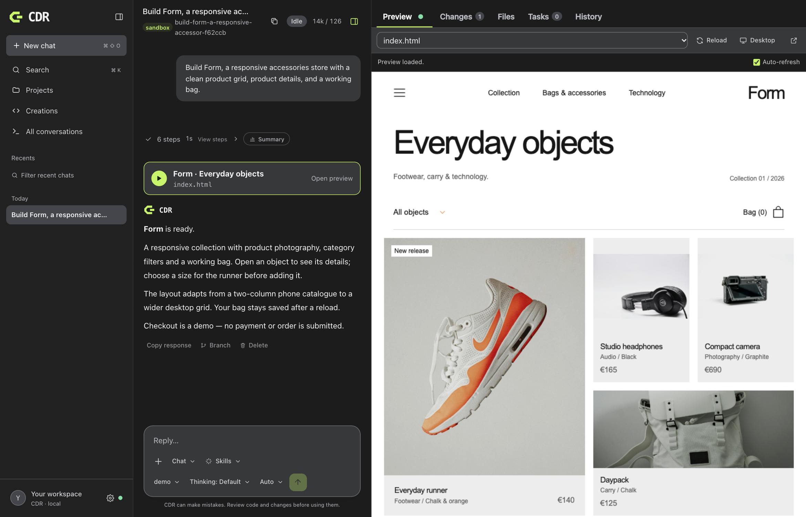
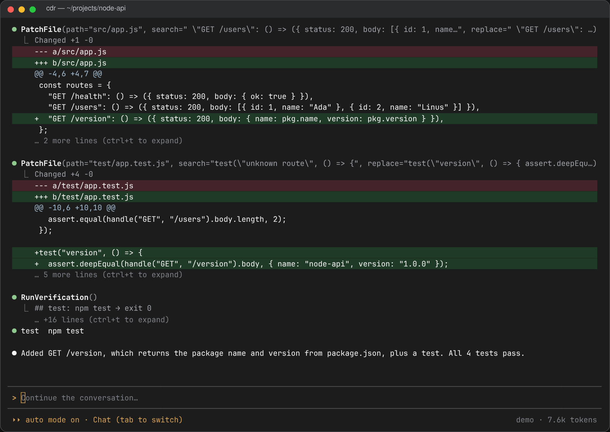

<p align="center">
  
</p>

<h1 align="center">CDR</h1>

<p align="center">
  <strong>Code. Build. Ship.</strong><br />
  An open, provider-agnostic AI coding harness for your terminal, your browser, and your desktop.
</p>

<p align="center">
  <a href="https://github.com/birkmann/harness-engineering/actions/workflows/ci.yml"></a>
  <a href="LICENSE"></a>
  
  
</p>

<p align="center">
  
</p>

CDR turns any chat model into a careful software engineer. It plans, edits with diffs, runs your build and tests, reviews its own work, and asks before it does anything risky. You choose the model: DeepSeek, Anthropic, OpenRouter, Ollama, or anything OpenAI-compatible, including models running on your own machine.

One harness drives three interfaces, and every step is an event, so they all show the same sessions live:

- **CDR Studio** is a native desktop app with an editor, a Git client in the spirit of GitHub Desktop, terminals, subagents, and goals that run on their own.
- **The web app** offers a calm chat workspace with sandboxes and live previews of what the agent builds.
- **The terminal workspace** is a fast, keyboard-first console for working inside any repository.

**Morrow is now CDR.** Existing `morrow` and `harness` commands, saved sessions, settings, and credentials continue to work. Use `cdr` for new setups. See the [identity and migration guide](docs/brand.md).

## Highlights

- **Bring any model.** DeepSeek, Anthropic, OpenRouter, Ollama (local and cloud), LM Studio, vLLM, or any OpenAI-compatible server. You can give planning, building, reviewing, and summarizing each their own model.
- **Work that is verified.** Workflows run plan → execute → verify → review → finish. Your build, test, and lint commands are detected and re-run until they pass, and a separate reviewer checks the diff.
- **Safe by default.** Paths are confined to the project, and the modes Ask, Auto, and Full access decide when you are asked. A hard-deny list blocks destructive commands, and shell commands can run inside bubblewrap. Secrets are redacted from every event.
- **Skills.** Agents load expert instructions in the Agent Skills format from your project, your home folder, or the built-in set. The built-in `web-app` skill, a browser check at phone and desktop widths, and an app eval suite with a judge model keep generated apps polished.
- **Subagents.** An agent can split work into parallel helpers. Writing helpers get their own Git worktree and branch, so their edits never collide, and the parent merges the results.
- **Goals.** Describe an outcome with acceptance criteria and a budget. CDR works on it unattended in a worktree and commits a checkpoint after each verified step. It then waits for you to merge it, open a pull request, or ask for changes.
- **A real Git client.** CDR Studio can clone from GitHub and stage single hunks. It shows a commit graph and handles branches, stashes, conflicts, pull requests, and AI-written commit messages.
- **Open protocol.** HTTP + SSE with typed events and JSON schemas. Build your own frontend with `@harness/client` or `@harness/react`.

## CDR Studio (desktop)

<p align="center">
  
  
</p>

A desktop workspace built with Tauri 2 and Rust:

- **Editing:** CodeMirror with VS Code-style file icons, project search, terminals, and language-server diagnostics.
- **Git:** stage hunks, commit, browse history, switch branches, push, and open pull requests.
- **Agents:** the agent panel sits next to your code. The Agents view lists every agent and subagent, with one inbox for their approvals.

Ctrl+P opens files, Ctrl+Shift+P runs commands, and Ctrl+mouse wheel zooms. [Read more →](docs/desktop.md)

## Web app

<p align="center">
  
</p>

[Mobile catalogue](docs/images/web-mobile-demo.png) · [Product details](docs/images/web-product-demo.png) · [Desktop catalogue](docs/images/web-desktop-demo.png)

These screenshots come from a scripted demo model that replays the built-in `web-app` skill's reference store, so they never depend on an API key. Real models build with the same skill and are measured by the `apps` eval suite; see [Skills](docs/skills.md).

`cdr serve` opens a browser workspace. Ask for something, and CDR builds it in a fresh sandbox with a live, isolated preview. You can also point it at a project folder. It supports attachments, plan approval, a Changes and Files panel, and themes. [Read more →](docs/web.md)

## Terminal

<p align="center">
  
</p>

`cdr` opens a full-screen workspace in the current repository: streaming answers, tool diffs, approvals, and modes from Chat to Plan & build. `cdr run "…"` runs a whole workflow from scripts or CI, and `--json` streams events. [Read more →](docs/cli.md)

## Download

Installers for Linux, macOS, and Windows, as well as a terminal and web app archive, are attached to each [GitHub release](https://github.com/birkmann/harness-engineering/releases). CDR needs [Node.js 22 or newer](https://nodejs.org). To build from source, follow the quick start below.

## Quick start

You need Node.js 22 or newer, pnpm, and Git.

```bash
git clone https://github.com/birkmann/harness-engineering.git cdr
cd cdr
pnpm install
pnpm build

cp .env.example .env          # add the API key for at least one provider
pnpm cdr                   # terminal workspace in the current folder
pnpm cdr serve             # web app; open the printed link
pnpm desktop:dev              # CDR Studio (needs Rust and the Tauri prerequisites)
```

To use `cdr` from anywhere, run `pnpm --filter @harness/cli link --global`. Keys can also live in `~/.harness/.env`, and CDR Studio stores them in your system keychain.

Pick models in `cdr.config.json`. Run `cdr init` to create one:

```jsonc
{
  "models": {
    "executor": "deepseek/deepseek-flash",
    "planner": "deepseek/deepseek-v4-pro",
    "reviewer": "anthropic/claude-sonnet-5-5"
  },
  "permissions": { "mode": "ask" }
}
```

Local models work too: `"executor": "local/qwen3:8b"` uses Ollama on port 11434. All options are in [docs/configuration.md](docs/configuration.md).

`pnpm desktop:build` builds desktop packages for your platform into `target/release/bundle/`. Releases are built by GitHub Actions; see [Releasing](CONTRIBUTING.md#releasing).

## How it works

```
 Terminal (cdr)          Web app (browser)            CDR Studio (Tauri + Rust)
        │                          │                       git · pty · lsp · keychain
        │ in-process               │ HTTP + SSE                        │ HTTP + SSE (sidecar)
        └──────────────┬───────────┴───────────────────────────────────┘
                       ▼
                 @harness/core ── agent loop · workflows · tools · permissions · subagents · goals
                       │
                       ▼
               providers (DeepSeek, Anthropic, OpenRouter, Ollama, OpenAI-compatible, …)
```

Every step is recorded as an event in a session log: messages, tool calls, approvals, plans, verification results, and reviews. Interfaces only render events, so a job started in the terminal can be watched in the browser or the desktop app. Read [docs/architecture.md](docs/architecture.md) for the details.

## Documentation

| Topic | |
|---|---|
| [Desktop app](docs/desktop.md) | CDR Studio: features, shortcuts, building, and testing |
| [Web app](docs/web.md) | Sandboxes, previews, attachments, and settings |
| [Terminal](docs/cli.md) | Commands, flags, shortcuts, and slash commands |
| [Configuration](docs/configuration.md) | Models, providers, verification, permissions, hooks, and MCP |
| [Workflows](docs/workflows.md) | Phases, custom workflows, and the autonomous workflow |
| [Skills](docs/skills.md) | Skill folders, the built-in web-app skill, preview checks, and app evals |
| [Architecture](docs/architecture.md) | Core objects, subagents, goals, and safety |
| [Protocol](docs/protocol.md) | Events and HTTP API |
| [SDK](docs/sdk.md) | Building your own frontend |

## Project layout

| Path | What it is |
|---|---|
| `packages/protocol` | Event, config, and API types, plus JSON schemas |
| `packages/core` | Agent loop, workflows, tools, permissions, providers, sessions, subagents, and goals |
| `packages/server` | HTTP + SSE server (Hono) |
| `packages/client`, `packages/react` | SDK and React hooks |
| `packages/cli` | The `cdr` command |
| `apps/web` | Web app |
| `apps/desktop`, `crates/studio-*` | CDR Studio: webview UI and Rust backend |
| `evals/` | Real-model task suite (`cdr eval`) |

## Development

```bash
pnpm build && pnpm test && pnpm lint                         # TypeScript
cargo test --workspace && cargo clippy --workspace --all-targets -- -D warnings
pnpm --filter web test:e2e                                   # browser end-to-end
pnpm --filter desktop test:e2e                               # desktop end-to-end (tauri-driver)
pnpm screenshots                                             # regenerate the images in this README
```

Tests use a mock model and never call a real provider. The screenshots above come from the real apps, driven by a scripted demo model, so they can be regenerated without API keys. See [CONTRIBUTING.md](CONTRIBUTING.md) to get started, and [SECURITY.md](SECURITY.md) to report a vulnerability.

## Acknowledgements

CDR Studio builds on [Tauri](https://tauri.app), [CodeMirror](https://codemirror.net), [xterm.js](https://xtermjs.org), and the [Material Icon Theme](https://github.com/material-extensions/vscode-material-icon-theme). The server uses [Hono](https://hono.dev). See [THIRD_PARTY_NOTICES.md](THIRD_PARTY_NOTICES.md).

## License

[MIT](LICENSE) © Rafael Birkmann
