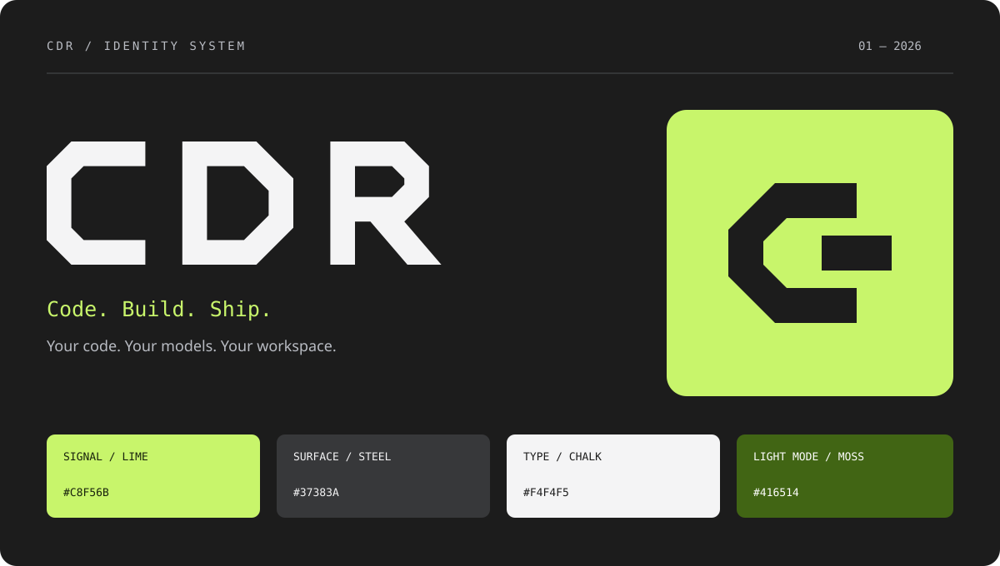

# CDR identity

**CDR** is the product name; **CDR Studio** is the desktop app; **`cdr`** is the command. Always capitalize the name. The tagline is **Code. Build. Ship.**

## Mark and wordmark

The mark combines an angular C with a terminal cursor. Its solid geometry works in a terminal-inspired interface and at favicon sizes. Use the [app icon](images/logo.svg), [monochrome mark](images/mark.svg), or [vector wordmark](images/wordmark.svg). The in-app component is `CDRMark` in `apps/web/src/components/Brand.tsx`.

Keep at least a quarter of the mark's width clear around it. Minimum mark size: 16 px. Use lime on graphite, moss on light surfaces, or a single high-contrast color. Do not add gradients, outlines, shadows, or rotation to the mark. The SVG wordmark is for standalone brand artwork; the UI uses a compact bold monospace wordmark.

## Palette and type

| Role | Dark | Light |
| --- | --- | --- |
| Canvas | Graphite `#1C1C1C` | `#F7F8F5` |
| Elevated surface | Steel `#37383A` | `#FFFFFF` |
| Primary text | Chalk `#F4F4F5` | `#22231F` |
| Accent | Signal lime `#C8F56B` | Moss `#416514` |
| Secondary text | `#B8BBC2` | `#64665E` |

Use lime sparingly for identity, focus, and active elements. Body text stays neutral. Plan stays blue, Chat teal, Review violet, and Quick fix amber so modes remain distinguishable. The other optional themes keep their own accents.

Use the system sans-serif stack for reading and controls, and the system monospace stack for branding, code, and technical labels. No remote font request is needed. Prefer short, direct copy that describes the task or result.

## Names

- `cdr` is the executable. Run `pnpm --filter @harness/cli link --global` after building to install it.
- Project configuration lookup: `cdr.config.json`, `.cdr/config.json`, `harness.config.json`, `.harness/config.json`. The first existing file wins; `cdr init` preserves an existing file.
- Global home lookup: `CDR_HOME`, `HARNESS_HOME`, then `~/.harness`.
- Desktop environment options use `CDR_*` names. The desktop application ID is `io.github.birkmann.cdr` and the credential service is `cdr-studio`.
- Workspace packages are named `@harness/*`. Agent branches use the `cdr/` prefix.

## Updating assets

Edit the SVG source in `crates/studio-app/icons/cdr.svg`, keep `docs/images/logo.svg` and `apps/web/public/favicon.svg` in sync, and regenerate platform icons with the Tauri icon command. Capture the actual interfaces with `pnpm screenshots` after rebuilding. Screenshots use a scripted demo provider and isolated temporary workspaces.
