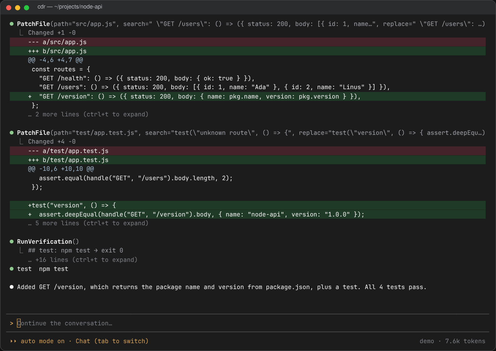
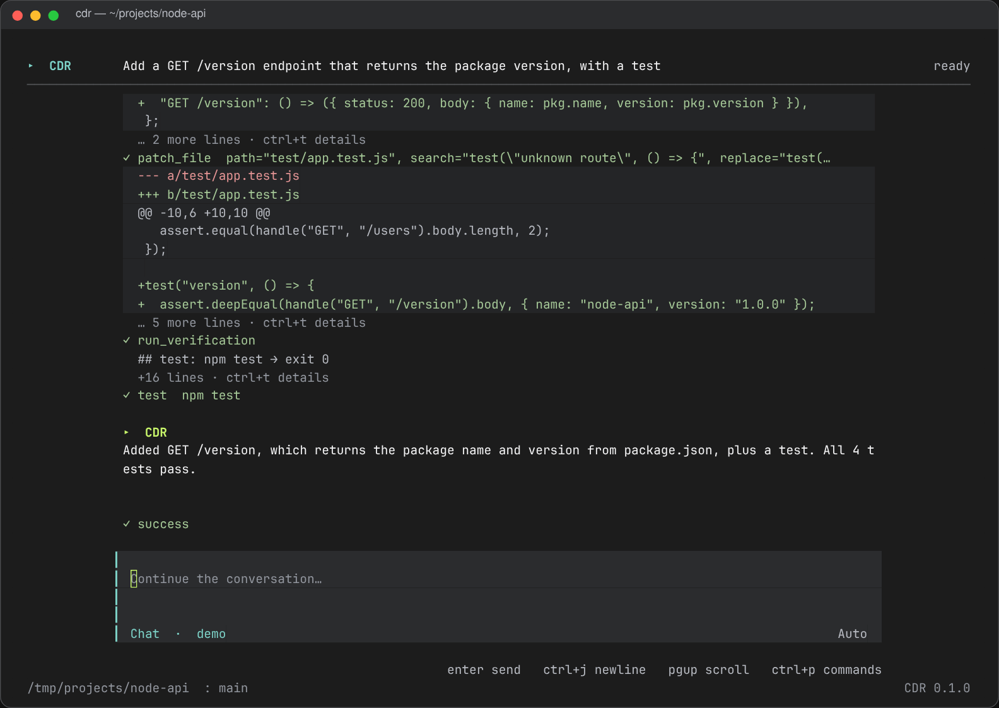

# Terminal (CLI)

The `cdr` command runs the harness in your terminal: a full-screen workspace for conversations and tasks, plus one-shot commands for scripts and CI.

```bash
cdr                                   # interactive session in the current directory
cdr run "add a /hello endpoint"      # plan → approve → execute → verify → review → report
cdr run "fix the failing test" -w quick-fix --yes
cdr plan "migrate to ESM"             # plan only, no edits
cdr review                            # review the current git diff
cdr resume <session-id>               # continue a session
cdr serve                             # HTTP + SSE server for frontends (prints a token once)
cdr models --remote                   # configured roles + models the providers offer
cdr init                              # cdr.config.json + AGENTS.md for this project
cdr eval --model deepseek/deepseek-flash
cdr recreate https://example.com/ --to static,react-vite   # 1:1 recreation (asks for consent)
```

`cdr recreate` is described in [recreate.md](recreate.md).

Useful flags: `-m provider/model` (all roles), `--executor/--planner/--reviewer`, `--mode ask|auto|yolo`, `--no-plan`, `--commit` (commit on a `harness/<slug>` branch), `--json` (JSONL events on stdout), `--skill <name>` (give the agent a skill, repeatable), `-v`.

`cdr` opens a full-screen terminal workspace in the style of other coding-agent CLIs: a welcome banner, a streaming conversation (`>` for you, `●` for the agent and its tool calls, `⎿` for results), tool diffs, a multiline prompt between two rules and a one-line status bar. It inherits your terminal colours (dark terminals work best); Ctrl+B toggles an optional workspace sidebar on wide terminals. When the executor model uses DeepSeek (and `DEEPSEEK_API_KEY` is set), the status line shows the remaining balance and the sidebar shows an ACCOUNT block with the remaining account balance from `GET /user/balance` and what this run has spent. It refreshes after each turn and every 5 minutes, and is hidden when the provider has no balance API. Type naturally or use `/run`, `/quick`, `/plan`, and `/review`.



Two looks are available. **Default** is the flowing layout above. **Classic** is the earlier look: a CDR wordmark home screen, a title bar, a centered composer box with a mode-coloured edge and a graphite and lime palette. Type `/terminal-design` to pick one, or `/terminal-design default`, `/terminal-design classic` or `/terminal-design toggle` to switch directly. The switch applies immediately, keeps the conversation, and is remembered in `~/.harness/tui.json` (under `$CDR_HOME` if set). It only affects the full-screen app, not `--plain`.



The task mode (Chat, Build, Plan, Quick fix, Review) is shown in the status line under the prompt; Tab cycles it. Thinking animates while the model is working, even between streamed updates. Plan-only mode produces a plan; select Build to implement it and create a runnable preview.

| Shortcut                                    | Action                                                      |
| ------------------------------------------- | ----------------------------------------------------------- |
| **Enter** / **Ctrl+J**                      | Send / insert a newline                                     |
| **Tab** / **Shift+Tab**                     | Next / previous task mode                                   |
| **Ctrl+P** or **/**                         | Search commands                                             |
| **Ctrl+O**                                  | Choose a model; **Ctrl+F** inside discovers provider models |
| **Ctrl+R**                                  | Resume a saved conversation                                 |
| **↑/↓**                                     | Move through multiline input or prompt history              |
| **PageUp/PageDown**, mouse wheel / trackpad | Scroll the conversation                                     |
| **Ctrl+T** / **Ctrl+B**                     | Toggle tool and reasoning details / workspace sidebar       |
| **Esc** / **Ctrl+C**                        | Cancel a running turn                                       |
| **Ctrl+D**                                  | Exit and restore the shell                                  |

The terminal UI captures mouse wheel events so scrolling moves the conversation instead of recalling prompt history. While capture is on, select text with Shift held (Option in iTerm2), or set `CDR_NO_MOUSE=1` to turn capture off.

Approval dialogs support keyboard selection; plans can be edited before approval. Bracketed paste keeps multiline text in the draft until you send it. Use `cdr --plain` for the simple text interface with Tab command completion and `\` multiline continuation. Pipes, `--json`, and dumb terminals use the text interface automatically.

In approval dialogs, use arrow keys or Tab to select and Enter to confirm. Permission shortcuts **1**, **2**, and **3** immediately choose Allow once, Always, and Deny. The run timeout (`limits.timeoutMs`, one hour by default) counts active work; waiting for permissions, plan decisions, or answers pauses it. The terminal displays **Waiting for you** and pauses its elapsed timer until you respond.

- `/model provider/model` switches all roles, with changes saved to the session. `/models` lists configured models; `/models remote` discovers provider models.
- `/mode ask|auto|yolo` changes and persists permissions.
- `/skills` lists skills (a picker in the full-screen UI, which also shows them under **Ctrl+P**). `/tdd fix the parser` sends a message with the `tdd` skill's instructions; `--skill <name>` does the same for one-shot runs and the first chat message. See [skills.md](skills.md#selecting-a-skill-for-a-message).
- `/attach path` attaches a project file or image to the next chat/task. `/attachments clear` removes pending files.
- `/new`, `/sessions`, and `/resume <id>` manage conversations without restarting the CLI. `/new` in a sandbox creates a fresh sandbox with the same confinement policy. Resume restores the transcript and prompt history.
- `/continue` continues the last failed or stopped job in the same session. It reuses the approved plan and executor context, restores the checklist, preserves files, and starts a fresh run budget. The web app exposes the same action as **Continue job** above the composer. Unapproved plans still require approval; verification and review run again as configured.
- `/status`, `/cost`, `/diff`, and `/clear` show context, usage, changes, and a fresh terminal screen.
- `/rewind` lists the checkpoints of the conversation (one is saved before every turn); `/rewind <n>` resets the project files to how they were before that message, and `/rewind undo` reverts the last restore. The web app offers the same as **Restore files to here** on each message. See [configuration.md](configuration.md#checkpoints).
- `/help` lists all commands. Streaming output, tool results, diffs, elapsed time, permissions, and cancellation work in the terminal; `--json` keeps stdout as machine-readable events.

Without installing a global command, run `pnpm cdr` for the console or `pnpm cdr serve` for the web app.

In Chat mode, files the agent creates are saved outside the project, in `~/Documents/CDR/<first message>-<id>/`, so asking for a poem or a note does not add a file to your repository. The tool result shows the full path, which `read_file`, `list_dir`, `glob` and `grep` accept; `bash` still runs in the project. Files that already exist in the project, and new files in a folder the project already has (such as `src/`), are still written in the project (with the usual permission prompt), and Build, Plan, Quick fix and Review modes write into the project as before. Change the folder with `outputDir` in the config or the `CDR_OUTPUT_DIR` environment variable, or set `"outputDir": false` to write new files into the project.

Starting a new session from your home directory, the filesystem root, or CDR's sandbox container creates a fresh sandbox automatically. Starting inside a project keeps that project as the workspace. Files and previews stay within that workspace. Older sessions rooted in a home directory show only successfully edited files and the folders containing their published previews, rather than listing your home directory. Existing files are not moved.

## Installing the command and credentials

Optionally link the binary: `pnpm --filter @harness/cli link --global` → `cdr`.

From a fresh terminal, use `cdr` after linking, or change into this repository and run `pnpm cdr`. If the linked command is not found, ensure pnpm's global binary directory is on your `PATH`. After updating the repository, run `pnpm build`, restart `cdr serve` when its jobs have finished, and refresh the browser to load the new UI and server behavior.

See [.env.example](../.env.example) for provider and optional Unsplash credentials. Copy it to `.env` only if you do not already have one; otherwise add the missing variables to your existing file. To make credentials available when starting CDR from any directory, put them in `~/.harness/.env` (or `$CDR_HOME/.env`). Existing shell variables take precedence. `cdr serve` also loads the launch directory's `.env` for new web sandboxes. Restart the server after changing keys.
