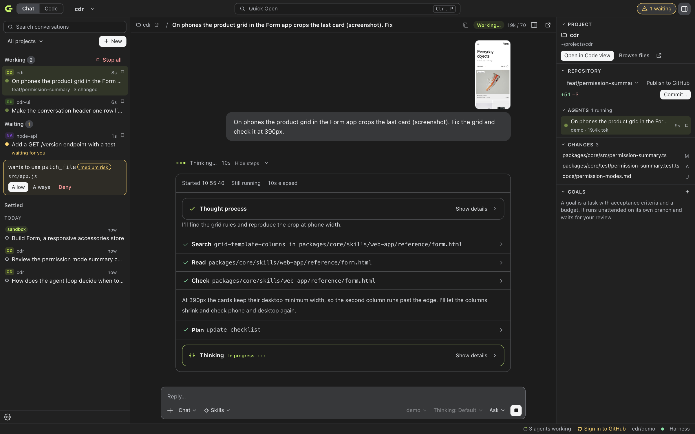
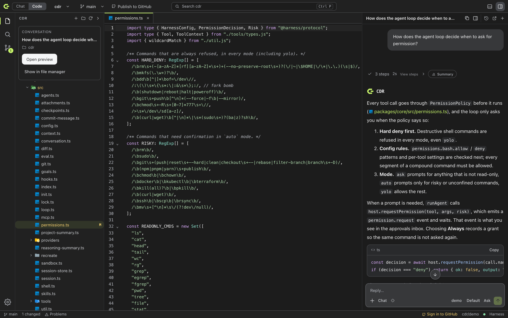
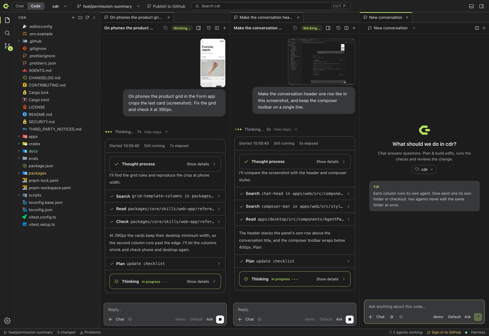

# CDR Studio (desktop)

CDR Studio is the native desktop app for the CDR harness. It is a Tauri 2 application. A Rust backend handles Git, terminals, file watching, language servers, credentials and the harness process. The webview UI reuses the web app's chat components.

## Run it

Requirements:

- Node.js 22 or newer.
- pnpm.
- Rust 1.80 or newer.
- Git 2.31 or newer.
- On Linux, WebKitGTK 4.1 and its development packages (`webkit2gtk-4.1`, `libsoup-3.0`, `javascriptcoregtk-4.1`).

```bash
pnpm install
pnpm desktop:dev      # builds the packages, bundles the harness, starts Vite and the app
pnpm desktop:build    # installers for this platform under target/release/bundle/
```

`pnpm desktop:dev` runs `tauri dev` from `apps/desktop`. Vite serves the UI on port 5174, and the Tauri crate lives in `crates/studio-app`.

Installed packages run the bundled harness, `harness/cdr.mjs` from the app's resources, with the Node.js found on the machine. A development build uses `dist-harness/cdr.mjs` or `packages/cli/dist/bin.js` from the checkout instead.

| Variable | Effect |
|---|---|
| `CDR_NODE` | Path to the Node.js binary. The default is `node` on `PATH`, then the login shell's `PATH`, then the newest nvm install. |
| `CDR_HARNESS_ENTRY` | Harness script to run instead of the bundled one. |
| `CDR_STUDIO_SERVER` and `CDR_STUDIO_TOKEN` | Attach to an already running `cdr serve` instead of starting one. |
| `CDR_GITHUB_CLIENT_ID` | Enables browser sign-in to GitHub through an OAuth app's device flow. Without it, use a token or the GitHub CLI. |
| `CDR_KEYS_BACKEND=file` | Store secrets in a 0600 file instead of the OS keychain. |

## How it fits together

```
Webview (React, CodeMirror 6, xterm.js, @web chat components)
   │ Tauri IPC                          │ HTTP + SSE (@harness/client)
Rust (crates/studio-app)                ▼
   studio-git    git CLI           harness server (Node sidecar, 127.0.0.1:random, per-launch token)
   studio-pty    terminals            sessions, tools, workflows, subagents, goals
   studio-watch  file watcher
   studio-lsp    language servers
   studio-keys   keychain
```

- **Harness sidecar.** At launch the app starts `cdr serve --port 0 --token-env CDR_STUDIO_TOKEN --ready-json` and passes Tauri's origins with `--origin`.
  - The token is generated per launch and travels only through the environment and IPC.
  - The server restarts with backoff, up to five times. Its log is under Panel → Harness log.
- **Agents.** Agents live in the harness. The app renders the harness's events and keeps no agent state of its own, so the CLI, the web app and the desktop app share sessions and goals.
- **Git.** `studio-git` runs the git CLI, so your credential helpers, SSH agent, hooks and config apply.
  - After you sign in to GitHub, the token is passed to git as an HTTPS header through git's `GIT_CONFIG_*` environment variables. It never appears on a command line.
- **Keys.** Provider API keys saved in Settings → Model providers go to the OS keychain. On Linux this is the Secret Service, with a file fallback.
  - The keys are injected into the harness process only. Saving a key restarts the harness.
  - Keys in a project `.env` or `~/.harness/.env` still work and take precedence.

## Using the app

The app has two views of the same window. The **Chat** / **Code** switch in the title bar (Ctrl+Shift+U) changes between them. It only rearranges the window: open files, terminals and the conversation stay as they are.

### Chat view

The app starts here. Read it from left to right: what exists, what you are working on, what it touches.



| Column | What it shows |
|---|---|
| **Conversations** | Every conversation in any folder or sandbox, with its project. **Working** lists what runs now, with elapsed time, a stop button per conversation and **Stop all**. **Waiting** lists what is blocked on you; permission requests from a conversation or its subagents are answered right in the list. **Settled** lists the rest by date, with a delete button on hover. Search by title or project, or filter by one project (Ctrl+R focuses the search). Ctrl+click or middle-click opens a conversation in an editor tab. Conversations whose folder is gone are listed under **Folder deleted**. |
| **Conversation** | The conversation and its message box, or the new-conversation screen. The header reads `project / title`: click the project to narrow the list to it, click the title to rename. A new conversation starts in the project you just left; **Work in** picks another folder or a new sandbox. |
| **Project** | The selected conversation's project, whether or not it is open in the editor. **Repository**: branch and line counts, with branch switching when the project is the open folder. **Agents**: what runs in this project and the conversation's subagents, with model, tokens and a stop button. **Changes**: click a file to see its diff. **Goals**: define a goal with acceptance criteria, a budget, permissions, models and an optional schedule, then run it unattended and review its checkpoints; merge, open a pull request, request changes or discard it. **Preview**: the conversation's published page. Collapse any section; hide the column with the button in the title bar. It also gives way when the window is narrow. |

**Files beside the chat.** Click a file name in a message or a tool step and it opens on the right, next to the conversation, without leaving the chat view. The conversation and the file share the space evenly (drag the divider to change it). The file pane has tabs, a narrow folder tree with file search, Markdown rendering, line wrapping and a button that opens the file in the Code view. Files are read-only here and update as the agent changes them. Each project keeps its own tabs. **Browse files** in the project column opens the pane without a link. Names only become links when the project really has such a file; a name that fits several files stays plain text.

**Previews beside the chat.** A page the agent publishes while you watch opens on the right, next to the conversation, as a **Preview** tab that shares the pane with file tabs. Open it again from the card in the conversation or the project column's **Preview** section. Each conversation keeps its own preview, and it stays loaded while you look at a file. The button in the pane's toolbar moves it to the Code view, which is the only way a preview leaves the Chat view.

You get an OS notification when an agent waits for you while the window is in the background; clicking it selects that conversation. The **N waiting** button in the title bar does the same from either view. See [agent-control.md](agent-control.md).

### Code view

The Code view of a project is an editor layout: files on the left, editors and previews in the middle, the conversation on the right. Opening it switches to the selected conversation's project; if files have unsaved changes, it stays on the current project and says so. Anything that needs an editor (a file you open here, a diff, a commit, a goal, a terminal) goes to this view by itself. Previews do not: they stay in the Chat view unless you open one in the Code view.



| Area | What you can do |
|---|---|
| **Explorer** (Ctrl+Shift+E) | Browse files with Git decorations. Create, rename and delete files and folders, and send a file to the agent. The top shows the selected conversation: its folder (click to reveal the folder its preview was published from, such as `.harness/chess-game`), **Open preview**, and **Show its files** when it works in another folder. With no folder open, the explorer opens the selected conversation's folder by itself; switching folders keeps conversation and preview tabs open. |
| **Editor** | Tabs and syntax highlighting for common languages. Split into up to four groups side by side with Ctrl+\\, the split button, or by dragging a tab to the left or right edge of an editor; a group closes when its last tab does. Save with Ctrl+S; find and replace with Ctrl+F. The gutter marks changed lines. Diagnostics come from language servers, and files reload when the agent changes them on disk. |
| **Search** (Ctrl+Shift+F) | Search the project with regex, case and whole-word options and include globs, then replace all matches. |
| **Source control** (Ctrl+Shift+G) | Stage, unstage and discard files or single hunks, then commit or amend. Abort or continue a merge or rebase, and resolve conflicts in a three-way view. Manage branches (checkout, merge, rebase, rename, delete), stashes, pull requests and agent worktrees. The sparkle button in the message box writes a commit message from the staged changes, or from all changes when nothing is staged, with the model chosen in the agent panel. |
| **History** | View the commit graph across all branches, search it and inspect commits file by file. Cherry-pick, create a branch from a commit, or check one out. |
| **Title bar** | Switch repositories, open a folder, or clone. Switch or create branches. A single sync button publishes, pulls, pushes or fetches, depending on the branch state. |
| **Clone** | Paste a URL or pick one of your GitHub repositories. Progress is shown while cloning and can be cancelled. |
| **Chat column** (Ctrl+L) | The same conversation view as the web app, with modes, models, thinking effort, permissions, approvals, plans, previews and Continue job. "@ Context" attaches the current file, the uncommitted diff or the Problems list. The conversation name at the top of the panel opens your history: every conversation, newest first, with the open folder's conversations on top and a search box. With no folder open, a conversation works in a sandbox under `~/.harness/sandboxes/`. Click its name in the conversation header to open it in the Explorer, or click the arrow next to it to show it in the system file manager. |
| **Conversations in tabs** | Run and watch several conversations at once. Each conversation has one header row: its title, then the code panel, history, split and + buttons. In the agent panel, the arrow button moves the conversation into an editor tab (or drag it beside an editor to split). In a conversation tab, the split button starts another conversation to the side and + starts a new one in place. In narrow groups the header and message box drop the folder, token count and picker labels so everything stays on one line. In the chat view's list, Ctrl+click or middle-click a conversation to open it in a tab. The palette has **Agent: New conversation in editor tab** and **Agent: New conversation to the side**. With two permission prompts on screen, Y and N answer only the conversation you clicked into. |
| **Panel** (Ctrl+J) | Terminals, Problems with "Ask agent to fix errors", and the harness log. |
| **Open file** (Ctrl+O) | Choose a file in the native file dialog. Files in the current folder open in an editor tab. For a file outside it, Studio offers to switch to the containing folder; save modified files first. With no folder open, Studio opens the file's containing folder. |
| **Open folder** (Ctrl+K, then Ctrl+O) | Choose a workspace folder. |
| **Quick Open** (Ctrl+P) | Search project files by name and press Enter to open one. Type `>` to search commands instead. |
| **Command palette** (Ctrl+Shift+P or F1) | Search commands: Git actions, themes, package scripts and the harness. |
| **Zoom** | Ctrl+mouse wheel, Ctrl + / Ctrl − (also on the numpad) and Ctrl+0 scale the whole interface, like VS Code. The level is remembered; the status bar shows it when it is not 100% and resets it on click. |
| **Settings** (Ctrl+,) | Theme, file icons, provider keys, GitHub sign-in, clone folder and harness status. |



Ctrl+Shift+A and Ctrl+Shift+J go to the Agents and Goals sections of the chat view's project column. Ctrl+I starts a new conversation.

### File icons

Files and folders show colorful file-type icons by default, as in VS Code. HTML, CSS, JavaScript, TypeScript, Rust, `package.json`, `README.md`, `.gitignore`, and folders such as `src`, `docs` or `node_modules` each get their usual icon. Icons appear in the explorer, tabs, search results, source control, history and the file finder.

To switch to simple outline icons, choose **Monochrome** under Settings → Appearance → File icons. The choice is remembered on this computer.

The icons come from the [Material Icon Theme](https://github.com/material-extensions/vscode-material-icon-theme) (MIT license). They are matched like VS Code does: by exact file name first, then by the longest extension, so `app.test.ts` gets the test icon and `types.d.ts` the declaration icon.

### Subagents

During a task the agent can call `spawn_agent`.

- **Read-only helpers** share the checkout.
- **Writing helpers** get a worktree under `.harness/worktrees/` on a `cdr/<parent>/<task>` branch. Their work is committed there, and the parent merges it.
- **Watching them.** Each helper appears under its parent in the chat view's project column and has its own log. A helper's approvals appear under its parent in the conversation list.
- **Limits.** By default at most three helpers run at once per agent, with a maximum depth of two. No new helper starts while eight agents already run in the window. Change this with `agents.maxConcurrent`, `agents.maxDepth` and `agents.maxActive` in `cdr.config.json`.
- **Keeping them under control.** [agent-control.md](agent-control.md) explains where every agent comes from, what it costs, how to stop and clean it up, and how to run many at once.

### Goals

A goal runs the `autonomous` workflow in a worktree on `cdr/goal-<slug>`:

1. Plan.
2. Execute, with a fresh context per step.
3. Verify.
4. Review the acceptance criteria.
5. Commit a checkpoint.
6. If criteria remain unmet, start another round, up to the round limit.

It stops when every criterion is met, when a budget runs out (status "Needs attention"), or when you pause it.

Nothing reaches your branch until you click **Merge**. Nothing is pushed until you choose **Open pull request**.

Scheduled goals, either once at a time or repeating by cron, start while the app is open. Use the CLI to run goals without the app:

```bash
cdr goal new "Add CSV export" --criteria "pnpm test passes" --budget-cost 2
cdr goal run <id>
```

## Development

| Path | Contents |
|---|---|
| `apps/desktop/src/ipc.ts` | Typed wrappers for every Rust command. Command names match `crates/studio-app/src/commands/*.rs`. |
| `apps/desktop/src/store.tsx` | Workspace, tabs, buffers, Git status and layout. |
| `apps/desktop/src/components/` | Views. The web app's components are imported as `@web/...`, which aliases `apps/web/src`. |
| `crates/studio-*` | Library crates, each with its own tests. |

```bash
pnpm test                      # TypeScript tests, including apps/desktop unit tests
cargo test --workspace         # Rust tests (git, pty, watch, keys, lsp, app)
cargo clippy --workspace -- -D warnings
pnpm --filter desktop build    # type-check and build the UI

# The window layout in a browser, on any platform: the real UI and harness server with a mock model;
# only the Rust commands are replaced. E2E_BROWSER=webkit runs the macOS app's engine.
pnpm build && pnpm --filter desktop build && pnpm --filter desktop test:e2e:shell

# End-to-end through the real app (WebDriver, not available on macOS; mock model, temporary repo, no network):
cargo install tauri-driver --locked          # once; needs WebKitWebDriver on Linux
pnpm --filter desktop build && cargo build -p studio-app --features tauri/custom-protocol
pnpm --filter desktop test:e2e               # STUDIO_BIN=<path to AppImage> tests a release bundle
```

## Known limitations

- **Node.js.** Release bundles need Node.js 22 on the machine. The `.deb` and `.rpm` declare it as a dependency; the AppImage does not include it.
- **Language servers.** Diagnostics only. There is no completion, hover or go-to-definition from the language servers yet. Servers are used only when installed: `typescript-language-server`, `rust-analyzer`, `pyright-langserver`, `gopls`.
- **Platforms.** The release workflow builds macOS (universal) and Windows installers. They are not code-signed yet, and they are tested less than the Linux build.
- **Editor.** The diff view is unified; there is no side-by-side view.
